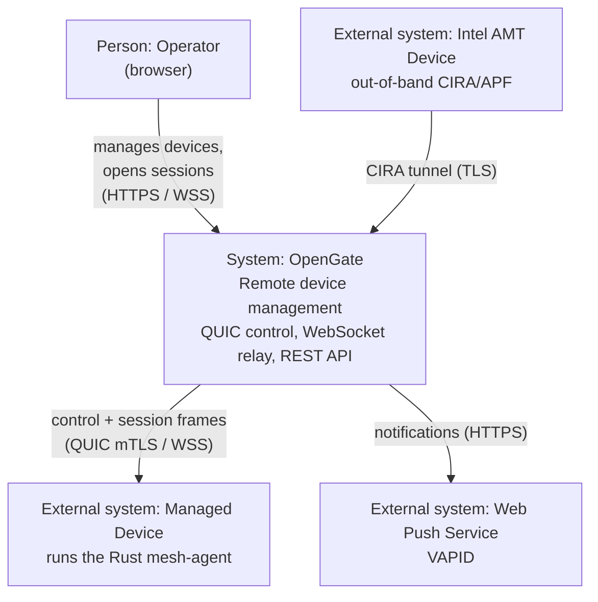
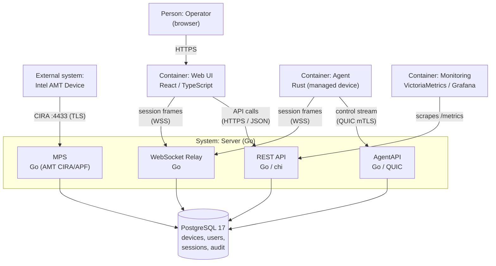
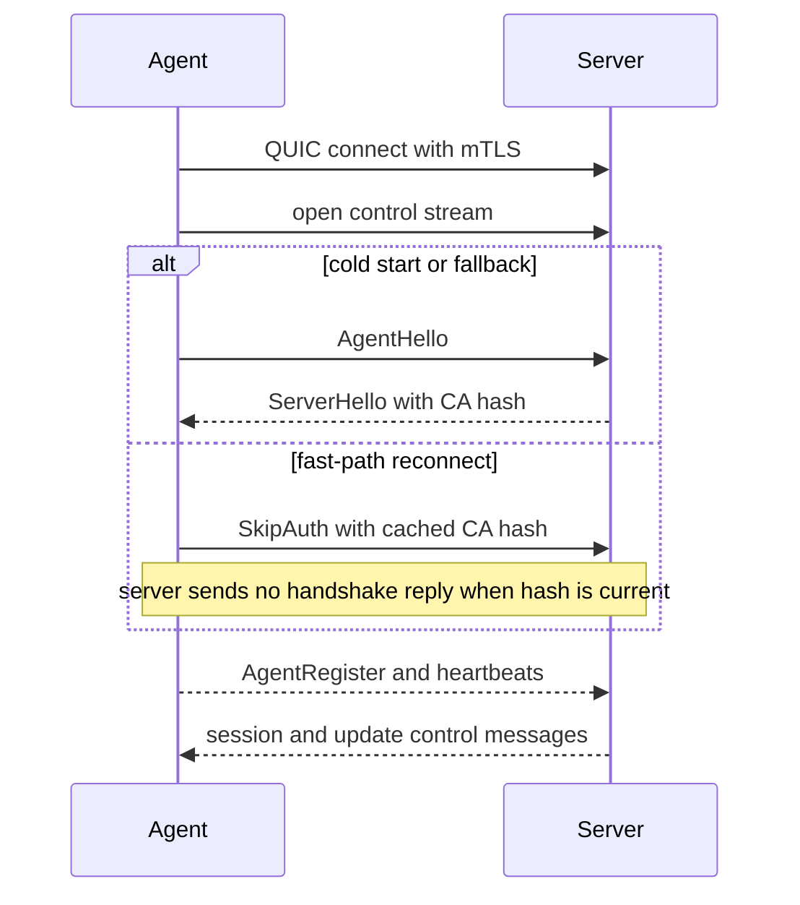
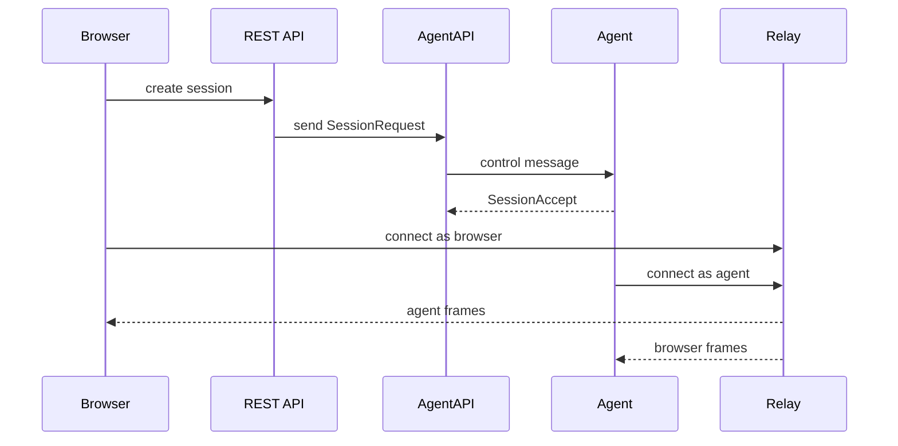
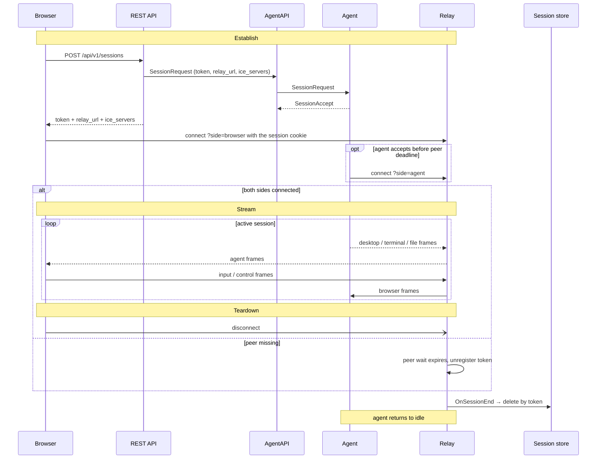
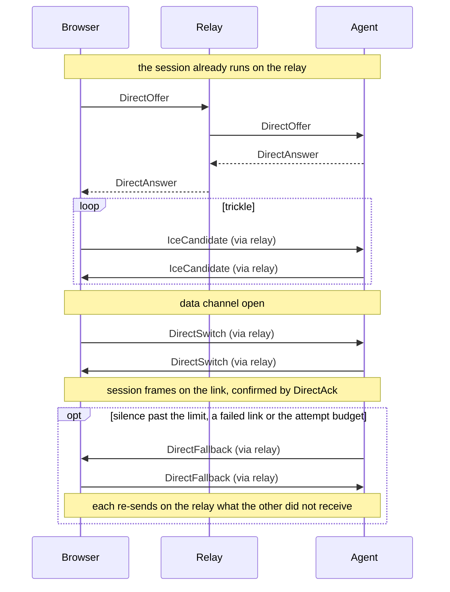

# System Architecture

- [What the system is](#what-the-system-is)
- [System context](#system-context)
- [Containers](#containers)
- [Drift checks](#drift-checks)
- [Connections](#connections)
  - [Agent to server](#agent-to-server)
    - [Enrollment on first boot](#enrollment-on-first-boot)
    - [Certificates after enrollment](#certificates-after-enrollment)
  - [The agent binary](#the-agent-binary)
  - [Browser to server](#browser-to-server)
- [Data flow](#data-flow)
- [The relay](#the-relay)
  - [Limits and cleanup](#limits-and-cleanup)
  - [What the relay reports](#what-the-relay-reports)
  - [Middleware compatibility](#middleware-compatibility)
- [Session lifecycle](#session-lifecycle)
  - [The direct link](#the-direct-link)
  - [Agent session handler](#agent-session-handler)
- [What the web client is for](#what-the-web-client-is-for)
- [Notifications](#notifications)
- [Intel AMT presence server](#intel-amt-presence-server)
  - [Design decisions](#design-decisions)
  - [Server flag](#server-flag)

## What the system is

OpenGate is a three-component platform for remote device management:

| Component | Language | Role |
|-----------|----------|------|
| **Agent** | Rust | Runs on managed Linux devices |
| **Server** | Go | Central hub — QUIC + WebSocket + REST API |
| **Web** | React/TypeScript | Browser-based management UI |

## System context

The L1 view places OpenGate among the people and external systems it interacts
with. It is drawn as a `flowchart` arranged along the C4 context level — the
documented fallback (see [docs/README.md](../README.md)) because native Mermaid C4
overlaps its relationship labels on GitHub's renderer. The C4 roles are carried
in the node labels.



## Containers

The L2 view decomposes OpenGate into its deployable containers (same C4 fallback
notation; the `Server (Go)` boundary is a subgraph).



## Drift checks

The diagrams are hand-curated Mermaid blocks. Structural drift is caught by the
existing boundary gates rather than generated diagrams: the
[precommit gauntlet](../../scripts/precommit-gauntlet.sh) and
[CI workflow](../../.github/workflows/ci.yml) run the Go, Rust, and web boundary
checks recorded in [ADR-020](../adr/ADR-020-module-boundaries.md).
[`scripts/tests/docs-diagrams.test.sh`](../../scripts/tests/docs-diagrams.test.sh)
keeps docs diagrams on the Mermaid-only, no-rendered-blob path.

## Connections

### Agent to server



#### Enrollment on first boot

The agent enrolls when its start-up decision says to — no identity yet, a
`--fresh` install, a different server, or a device the server deleted — and the
only input it enrolls with is the install note the installer leaves in its data
folder: the join code, the server address and the master keys the server
announced. The decision table is in
[`lifecycle.rs`](../../agent/crates/mesh-agent/src/lifecycle.rs) and its reasons
in [ADR-128](../adr/ADR-128-machine-identity-lifecycle.md).

1. Agent generates an ECDSA P-256 key pair and a PKCS#10 CSR
2. Agent POSTs the CSR to `POST /api/v1/enroll/{token}` with `{"csr_pem": "..."}`
3. Server validates the token, ignores the CSR's subject, chooses a device number with no device, deleted or certificate row ([`issuer.go`](../../server/internal/devicecert/issuer.go)), signs a certificate for it, records it in the certificate ledger, and returns the certificate, the device number and the trust bundle
4. Agent checks that the certificate carries the returned number and chains to the note's master keys, then saves the identity, the trust bundle and the update signing key through the crash-safe store ([`identity_store.rs`](../../agent/crates/mesh-agent-core/src/identity_store.rs)), deleting the note in the same commit
5. Agent proceeds to the QUIC mTLS connection using the new certificate

On later starts the agent loads its saved identity. The enrollment response also
includes the server's Ed25519 update signing key (if configured), which the agent
saves for verifying future OTA updates without requiring the
`--update-public-key` CLI flag.

#### Certificates after enrollment

- **Renewal** runs over the live control connection: the server offers
  `RenewCertificate` once two thirds of the presented certificate's life has
  passed, the agent answers with a CSR for a fresh key, and installs the
  `CertificateIssued` reply without reconnecting
  ([`renewal.go`](../../server/internal/agentapi/renewal.go),
  [`cert_renewal.rs`](../../agent/crates/mesh-agent/src/cert_renewal.rs))
- **Admission** classifies every client certificate in `VerifyConnection`, on
  resumed handshakes too ([`classify.go`](../../server/internal/cert/classify.go)),
  and then checks it against the in-memory index of the certificate ledger: a
  certificate the server never issued, or one a renewal superseded, is closed
  with code 5
- **An expired certificate** inside the grace is served by a restricted
  connection that holds no repository and accepts only registration and renewal
  ([`conn_restricted.go`](../../server/internal/agentapi/conn_restricted.go)); a
  deleted device's connection at any age receives its removal order first
  ([`admission.go`](../../server/internal/agentapi/admission.go))
- **A second connection** for one device replaces the first, which is closed
  with code 6 after a liveness ping decides whether two machines share the
  identity

The close codes are listed in [Wire Protocol](Wire-Protocol.md#close-codes).

The agent opens the control stream and speaks first; the server branches on the
first handshake byte in
[`handshaker.go`](../../server/internal/agentapi/handshaker.go). The cold path
binds `AgentHello` to the mTLS peer certificate, while reconnects may use
`SkipAuth` with the cached CA hash before framed MessagePack control messages
begin. Message layout details live in [Wire Protocol](Wire-Protocol.md).

### The agent binary

The `mesh-agent` binary (`agent/crates/mesh-agent/src/main.rs`) is the entry point for the Rust agent. It handles:

- **Start-up decision and enrollment**: Reads its data folder and the install note, finishes a half-done removal or enrolls where the table says, and otherwise loads its identity — see [Enrollment on first boot](#enrollment-on-first-boot)
- **QUIC mTLS connection**: Connects to the server using `quinn` with ALPN protocol `"opengate"`, client cert from the agent's identity, and the server CA for root verification
- **Binary handshake**: Sends `AgentHello` first on the cold path, reads `ServerHello` for the CA hash, and may use `SkipAuth` on reconnect
- **Registration**: Sends `AgentRegister` with hostname, OS, architecture, version, and capabilities. Linux reports Terminal, FileManager, HardwareInventory, and DeviceLogs; desktop capture/input capabilities are platform-specific.
- **Control loop**: Dispatches `SessionRequest` (spawns session handler), capability-gated hardware/log requests, `AgentUpdate` (semver check, apply, ack, exit code 42 for systemd restart), renewal messages, and pings. Log reads, hardware reports and update downloads each run in a task of their own with a deadline, one at a time per kind, so a stalled request never delays a heartbeat ([`requests.rs`](../../agent/crates/mesh-agent/src/requests.rs))
- **Edge Sentinel sampler**: A background sampler on every agent reads bounded local host/process metrics, trains a pure-Rust k=2 anomaly ensemble on a warm-up window, and scores each sample, with local allocation/RSS guards and a Criterion footprint bench.
- **Edge Sentinel local store**: On every agent, the local store persists each sampled dimension with its inline anomaly bit into the agent-local multi-tier TSDB (`edge-tsdb::store::LocalTsdb`) under the data dir — the sovereign copy of min/max/last + 1 s raw that central `avg`-only VictoriaMetrics does not keep, read back on demand by later backfill. It is built on `redb`: T0 1 s raw + T1 60 s + T2 3600 s rollups in three tables written per commit as one atomic transaction, a fixed-point-per-metric compact codec, a coarsest-first disk cap that never fills the host disk, format-version migration, MVCC snapshot reads, optional cold-tier DEFLATE (pure-Rust, no `zstd`), and a deprovision purge. See [ADR-052](../adr/ADR-052-agent-local-store.md).
- **Edge Sentinel correlation**: When something fires on a device, the agent ranks which of its own dimensions broke pattern over the event window against the stretch before it (`mesh-agent-core::correlate`), blending a two-sample Kolmogorov–Smirnov distribution shift, the share of readings outside the baseline's band, and how far the mean moved against the baseline's own scale. It reads the local store through an MVCC snapshot, so the sampler keeps writing underneath, and every run is bounded in dimensions, readings and wall-clock. The ranking travels with the alert, so an investigator opens it already knowing what else moved — and it ranks the 1 s detail only the device holds. See [ADR-068](../adr/ADR-068-system-event-rules.md).
- **Edge Sentinel auto-discovery**: A background task on every agent profiles the host non-intrusively — listening ports (`/proc/net`, with the owning process basename), systemd services, database engines inferred from listening ports, containers via a read-only docker/podman CLI, and installed packages (dpkg/rpm) — into a bounded, secret-free `DiscoveryReport` (`mesh-agent-core::discovery`). No network scanning; each category is capped, and the task profiles on a long interval and ships a report over a bounded channel **only when the profile changed**. Advertises the `Discovery` capability.
- **Auto-update**: Downloads binary, verifies SHA-256 + Ed25519 signature, atomic replace with `.prev` backup, rollback watchdog on restart. See [Agent Updates](../product/Agent-Updates.md)
- **Removal order**: On `AgentDeregistered` or close code 3, starts over with an install note when one is present, and otherwise removes itself in an order that resumes after a crash or a power cut. The server keeps an in-memory deny list of deleted devices and delivers the order before it closes
- **Reconnection**: Jittered backoff between 1 s and 30 s, without limit; a refused certificate or an unknown server chain is logged once an hour
- **Graceful shutdown**: On SIGINT/SIGTERM the background loops are asked to stop and given [`BACKGROUND_GRACE`](../../agent/crates/mesh-agent/src/main.rs), then the runtime is shut down with a bound of its own, under systemd `sd_notify` lifecycle notifications

### Browser to server

The console signs in to a server-side session held in an `HttpOnly`, `SameSite=Strict` cookie, with a synchronizer value in `X-CSRF-Token` on every request that changes something ([`session_cookie.go`](../../server/internal/api/session_cookie.go)); scripts and load runs sign in with a JWT bearer token. Passwords are bcrypt-hashed and stored in PostgreSQL. The REST API is defined by an OpenAPI 3.0.3 spec (`api/openapi.yaml`) and served by an `oapi-codegen` strict server on a chi v5 router. The same spec generates TypeScript types for the web client via `openapi-typescript` + `openapi-fetch`. See [API Reference](API-Reference.md) for endpoint details.

## Data flow

```
                    ┌─────────────────────────────────────────────┐
                    │               Server                        │
                    │                                             │
 Agent ──QUIC──►  AgentAPI  ──►  Postgres ◄──  REST API  ◄──HTTP── Web
                    │               │                             │
                    │           migrations                        │
                    │           (golang-migrate)                  │
                    └─────────────────────────────────────────────┘
```

- **AgentAPI** handles QUIC connections: handshake, registration, heartbeat, disconnect
- **REST API** serves device/site/customer/user management and authentication endpoints
- **PostgreSQL 17** (via `pgx/v5` stdlib adapter) is the shared persistence layer — see [Database](Database.md) and [ADR-014](../adr/ADR-014-postgresql.md)
## The relay

The server includes a message-oriented WebSocket relay (`server/internal/relay/`) for browser↔agent sessions:



1. The session tab creates a session via REST API (`POST /api/v1/sessions`) and gets back `{token, relay_url, ice_servers}`; the relay address is built from the tab's own request. A host another technician holds refuses with `409` and the holder's name ([ADR-059](../adr/ADR-059-session-row-lifecycle.md))
2. Agent receives a `SessionRequest` control message with the same token, the relay address the server is configured with (`OPENGATE_AGENT_RELAY_URL`, never read from a request — [ADR-116](../adr/ADR-116-forwarded-addresses.md)) and the same helpers
3. Both sides connect to the relay WebSocket at `/ws/relay/{token}` with their side parameter; the relay admits a browser side only from the session's holder
4. The relay pipes binary frames bidirectionally — desktop, terminal, file, and control frames all flow through the same connection
5. The browser side authenticates with the console's session cookie, and the upgrade is refused for an `Origin` other than the console's own; other clients send a bearer token in the `Authorization` header. The server re-checks the console session behind each open browser side every [`LiveSessionRecheck`](../../server/internal/api/api.go) and closes it once that session was signed out or passed its total limit
6. When the relay releases a token, its `OnSessionEnd` callback deletes the DB session record through a background, relay-scoped repository operation, keeping the session table consistent with active connections

### Limits and cleanup

- **Max message size**: [`MaxMessageSize`](../../server/internal/relay/message.go) per WebSocket message (prevents memory exhaustion from oversized frames); each side's sending point caps its frames far below it, and a directory listing travels in pages
- **Forwarding buffers**: Each message is read into a buffer borrowed from a size-classed pool and returned after the write, so an idle session holds no buffer and a 256 KiB file piece costs no fresh allocation
- **Ending a session from outside it**: `Relay.End` closes both sides of a live session with close code `StatusSessionEnded` and a reason the session tab shows — "Opened elsewhere" when its holder opens the host again, "Ended by <name>" when the holder or an administrator deletes it
- **Orphaned session cleanup**: When a relay send to an agent fails, the server automatically cleans up the orphaned session record from the database
- **Bounded unpaired release**: The relay bounds how long either side may wait for its peer. If that deadline expires, the handler releases the token — dropping the entry, the active-session count and the session row together
- **Background row deletion**: `OnSessionEnd` deletes by globally unique token through the relay-scoped repository path, so cleanup is not tied to a disconnected request's tenant context. Relay bookkeeping and row cleanup run before a potentially blocking graceful WebSocket close
- **Stale-session sweep**: A periodic sweep deletes session rows the relay no longer holds once they pass a grace period, which collects tokens that were issued but never connected and rows left behind by a process restart. Live sessions are named by the relay's active-token set and are never swept, however long they run
- **Handler lifetime**: `Register` hands the registering side the channel its session ends on, and the handler parks on that channel and on the server's lifetime context. `websocket.Accept` hijacks the connection, which untracks it, so the request context is cancelled by neither a client hangup nor `Server.Shutdown` — the relay is the only thing that knows the session is over. The handler closes its own WebSocket on the way out, because nothing in `net/http` will. See [ADR-093](../adr/ADR-093-relay-session-lifetime.md)
- **Shutdown drain**: A shutting-down process cancels the lifetime context and then waits on `Relay.WaitForDrain` under the shutdown budget, before `Server.Shutdown`, which cannot see a hijacked connection at all
- **Peer liveness**: Each parked handler pings its own connection on an interval and requires the pong back inside it, so a peer that vanished and a peer that is present and no longer consuming are both caught. One unanswered ping ends the session for both sides. There is no cap on a session's duration — a technician may legitimately hold one open for hours
- **Write budget, no read budget**: A forwarded frame carries a deadline, because a peer that stops draining lets the buffers fill and the write then blocks with no error. Reads stay undeadlined: a quiet session is legitimate, and liveness is the ping's job
- **Teardown order**: Both teardown paths update the count, the token set and the registry, and fire `OnSessionEnd`, *before* any graceful close — a close waits on an acknowledgement an absent peer never sends, and a finished session must not read as live meanwhile. The two sides are closed concurrently

See [ADR-059](../adr/ADR-059-session-row-lifecycle.md) for the cleanup invariants and failure recovery design.

### What the relay reports

The relay uses structured logging via `*slog.Logger` (injected at construction):

| Event | Level | Key Fields |
|-------|-------|------------|
| Session started | `Info` | `token_prefix` |
| Session ended | `Info` | `token_prefix` |
| Read/write error | `Error` | `direction`, `token_prefix`, `msgs_copied`, `error` |
| Connection established | `Info` | `token_prefix`, `side` |
| Connection disconnected | `Info` | `token_prefix`, `side` |
| Peer did not answer a ping | `Warn` | `token_prefix`, `side`, `error` |
| Upgrade/register failure | `Error` | `token_prefix`, `side`, `error` |

Set `LOG_LEVEL=debug` for per-message tracing. All tokens are redacted to 8-char prefixes via `protocol.RedactToken`.

### Middleware compatibility

The relay WebSocket route passes through global HTTP middleware (metrics, security headers, request logger). Any middleware that wraps `http.ResponseWriter` **must** implement `http.Hijacker` — WebSocket upgrades require connection hijacking. See `server/internal/metrics/middleware.go` for the reference implementation.

## Session lifecycle

End-to-end view of a browser↔agent session: establish (REST + control plane),
stream (bidirectional frames over the relay), and teardown. A paired session ends
when either connection leaves; an unpaired session ends when its peer wait expires.
Both paths release relay state, delete the session row, and close the session's
done channel, which is what returns the two parked handlers.



### The direct link

A session runs on the relay from the moment it is established. Once the relay
connects, the session tab tries once to move it onto a direct WebRTC link
carrying one ordered data channel. The relay stays open for the whole session:
it carries the negotiation, and it carries the session again if the link drops.
[ADR-127](../adr/ADR-127-direct-link.md) holds the rules and what was measured.



- **Link-control and session data.** `DirectOffer`, `DirectAnswer`,
  `IceCandidate`, `DirectRefused`, `DirectSwitch` and `DirectFallback` travel on
  the relay only and are never numbered or held. Every other frame is session
  data: numbered on the link, kept by its sender until a `DirectAck` confirms it,
  and re-sent through the relay after a fallback, so each direction delivers
  every frame once and in order across a change of path.
- **One sending point per side.** The host's
  [`session/core.rs`](../../agent/crates/mesh-agent-core/src/session/core.rs) and
  the browser's
  [`session-channel.ts`](../../web/src/lib/transport/session-channel.ts) keep two
  lanes — interactive before bulk — choose the path, and pace what they write to
  it, so typing overtakes a download on either path. The hand-off rules are a
  pure state machine on each side,
  [`handoff.rs`](../../agent/crates/mesh-protocol/src/direct/handoff.rs) and
  [`handoff.ts`](../../web/src/lib/direct/handoff.ts), held equal by the scenario
  files in [`testdata/direct-link/`](../../testdata/direct-link/).
- **The relay stays path-unaware.** It copies bytes between the two connections
  without decoding a frame, so the server sees the negotiation go past without
  reading it and holds no view of the link.
- **Helpers.** The server answers STUN Binding requests itself, on the agents'
  UDP port ([`stunhelper`](../../server/internal/stunhelper/helper.go)), bounded
  per address and in total. The list of helpers is the `OPENGATE_ICE_SERVERS`
  setting, read by [`config.go`](../../server/internal/signaling/config.go),
  returned in the create-session response and sent to the agent in
  `SessionRequest`.
- **Outcomes.** The session tab reports how its attempt ended to
  `POST /api/v1/sessions/{token}/outcome`, and the server counts it in
  `opengate_direct_link_outcomes_total` by outcome alone
  ([Metrics Reference](Metrics-Reference.md)).

### Agent session handler

When the server assigns a session to an agent, the agent connects to the relay at
`relay_url?side=agent` and the `SessionHandler` (Rust) drives the session:

- **Desktop capture** — JPEG-encoded screen frames at ~10 FPS (quality 70,
  falling back to raw on encode failure) from the platform's screen source; the
  agent binary wires the no-display stand-in on every host, so no host advertises
  remote desktop
- **Terminal** — spawns a PTY (`portable-pty`) and bridges stdin/stdout over
  terminal frames
- **File operations** — directory listing in pages of at most 16 KiB, each
  marked `more` until the last, and downloads read one 256 KiB piece at a time as
  the bulk lane drains, one download per session, permission-gated; a failed read
  or a second request while one runs answers `FileDownloadError`
- **Input injection** — mouse and keyboard events forwarded to the OS through the
  platform traits
- **Chat echo** — a `ChatMessage` from the browser is echoed back with
  `sender: "agent"`

## What the web client is for

The React client (`web/`) is the console: the fleet views, the session tabs, the
triage queue and the settings section. All of it uses the binary frame protocol
([`web/src/lib/protocol/`](../../web/src/lib/protocol)) and shares a single
WebSocket connection managed by a Zustand store
([`connection-store.ts`](../../web/src/features/session/state/connection-store.ts)).

What each screen gives a technician is in the product tree —
[Fleet and Devices](../product/Fleet-and-Devices.md),
[Remote Sessions](../product/Remote-Sessions.md),
[Investigations](../product/Investigations.md),
[Tenancy and Access](../product/Tenancy-and-Access.md) — together with the agent's
side of a session and the peer-connection upgrade.

## Notifications

The server delivers Web Push notifications
(`server/internal/notifications/`) for device and session lifecycle events; the
event set and what a technician sees are in
[Fleet and Devices](../product/Fleet-and-Devices.md#browser-notifications).

- **VAPID keys**: ECDSA P-256, auto-generated on first startup, stored in `{data-dir}/vapid.json`
- **Notifier interface**: Decouples notification logic from handlers (like `AgentGetter` pattern)
- **PushNotifier**: Sends Web Push via `webpush-go`; auto-deletes stale subscriptions on 410 Gone
- **NoopNotifier**: Used in tests and when push is disabled
- **Service Worker**: `web/public/sw.js` handles push events, offline caching, and notification click navigation

## Intel AMT presence server

The server includes an MPS (`server/internal/amt/transport/`) that accepts CIRA (Client Initiated Remote Access) connections from Intel AMT devices over TLS:

```
Intel AMT Device              MPS Server
  │                              │
  │──── TLS connect :4433 ──────►│  RSA 2048 server cert (TLS 1.2+)
  │                              │
  │──── ProtocolVersion ────────►│  UUID identifies device
  │◄─── ProtocolVersion ────────│
  │                              │
  │──── ServiceRequest (auth) ──►│  APF handshake sequence
  │◄─── ServiceAccept ──────────│
  │──── UserAuthRequest ────────►│
  │◄─── UserAuthSuccess ────────│
  │                              │
  │──── ServiceRequest (pfwd) ──►│
  │◄─── ServiceAccept ──────────│
  │──── GlobalRequest ──────────►│  tcpip-forward registration
  │◄─── RequestSuccess ─────────│
  │                              │
  │◄────► Channel Open/Data ────►│  APF channels for port forwarding
```

### Design decisions

- **RSA 2048 certs**: Intel AMT firmware requires RSA keys (not ECDSA). The MPS cert is signed by the MPS master key — `mps-ca.crt`, which defaults to the issuing master key — using `cert.SignMPS()`, and re-signed before it expires
- **TLS 1.2 minimum**: Supports AMT 11.0+ firmware (2015+) while maintaining modern security
- **APF protocol**: Based on SSH channel semantics (RFC 4254) with Intel extensions — message types for service request/accept, user auth, channel open/data/close, and port forwarding
- **AMT device tracking**: Separate `amt_devices` table (UUID primary key, hostname, model, firmware, status) independent from the agent `devices` table
- **Connection lifecycle**: Devices are set `online` on handshake completion, `offline` on disconnect, with per-device connection storage in `sync.Map`
- **Port forwarding channels**: Each AMT device can open multiple APF channels for forwarding TCP traffic to internal network services (e.g., AMT WSMAN on port 16993)

### Server flag

| Flag | Default | Description |
|------|---------|-------------|
| `-mps-listen` | `:4433` | MPS TLS address for Intel AMT CIRA connections |

The capability an administrator gets from an AMT-managed machine is in
[Intel AMT](../product/Intel-AMT.md).
