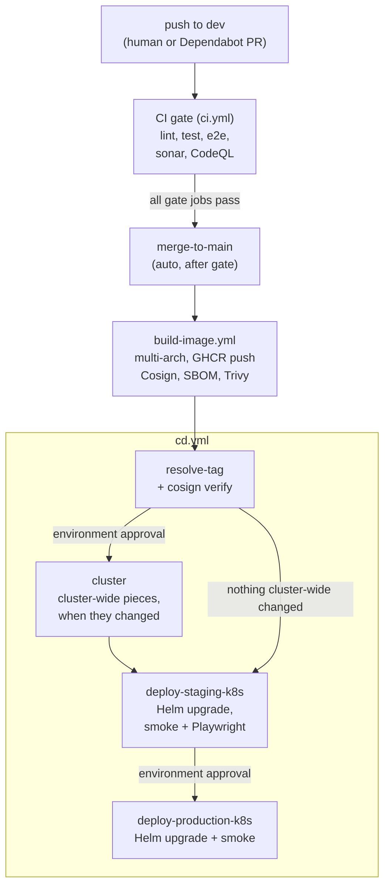

# Continuous Deployment

- [Pipeline](#pipeline)
- [Deployment model](#deployment-model)
- [Jobs](#jobs)
- [Staging checks](#staging-checks)
- [Production checks](#production-checks)
- [Image verification](#image-verification)
- [Skipping an unchanged deploy](#skipping-an-unchanged-deploy)
- [Rollback](#rollback)
- [Load tests](#load-tests)
- [Configuration and secrets](#configuration-and-secrets)
- [Failure notifications](#failure-notifications)

## Pipeline

The deployment chain is defined by the repository workflows:

1. [`ci.yml`](../../.github/workflows/ci.yml) validates changes.
2. [`build-image.yml`](../../.github/workflows/build-image.yml) publishes the signed
   server image.
3. [`cd.yml`](../../.github/workflows/cd.yml) verifies the image, deploys staging,
   validates it, and then deploys production after environment approval.

The CD workflow also supports a manual image-tag dispatch. Deployments are
serialized by the workflow's concurrency configuration.



## Deployment model

Both environments run on OKE and are managed by the
[`opengate` Helm chart](../../deploy/helm/opengate):

- Staging uses [`values-staging.yaml`](../../deploy/helm/opengate/values-staging.yaml).
- Production uses
  [`values-production.yaml`](../../deploy/helm/opengate/values-production.yaml).
- Cluster credentials and kubeconfig setup are owned by
  [`oci-kube-setup`](../../.github/actions/oci-kube-setup/action.yml). Both
  deploys sign in as the workflows' own login, which reads no secret and cannot
  read the master key; the `cluster` job alone signs in as an administrator
  ([Kubernetes](./Kubernetes.md#who-may-change-the-cluster)).
- Every Helm call keeps its release records in configmaps
  (`HELM_DRIVER=configmap`).

Each deploy creates the environment's shared Secret when it is absent and, when
it exists, patches the one value it rotates, reading nothing back. The master key
lives in a secret no deploy can read, written only by the in-cluster key tool
([Kubernetes](./Kubernetes.md#the-master-key)), so a deploy cannot rotate machine
identity material.

## Jobs

| Job | Purpose |
|-----|---------|
| `resolve-tag` | Resolves the image tag, verifies the image and signature, evaluates the unchanged-deploy fast path, and decides whether the cluster-wide pieces changed since the running commit. |
| `cluster` | Applies the cluster-wide pieces as an administrator, under the `production` environment's approval, when they changed or the running commit cannot be read. |
| `deploy-staging-k8s` | Applies the staging Helm release and runs smoke and browser tests. |
| `deploy-production-k8s` | Applies the production Helm release after staging succeeds. |
| `notify-failure` | Creates or updates the deployment failure issue. |

The exact job dependencies and environment approvals are canonical in
[`cd.yml`](../../.github/workflows/cd.yml).

## Staging checks

The staging job:

- waits for the server Deployment rollout;
- port-forwards the server Service to the runner;
- executes [`smoke-test.sh`](../../deploy/scripts/smoke-test.sh);
- resets the disposable staging database;
- brings up two machines running the agent binary
  [`build-image.yml`](../../.github/workflows/build-image.yml) built from the
  same commit;
- runs the staging
  [Playwright configuration](../../web/playwright.staging.config.ts).

The port-forward is temporary and does not expose staging publicly.

## Production checks

Production is deployed only after staging succeeds and the production
environment gate is approved. The workflow waits for rollout completion and
runs the same smoke-test script through a temporary Service port-forward.

Both deploys ask the cluster, as their own login, whether it may read the master
key's secret or list secrets, and fail on a yes
([`workflow-access-readback.sh`](../../deploy/scripts/workflow-access-readback.sh)).
Production also proves the master key's admission rule exists and refuses every
shape of outside reader it names
([`authority-readers-check.sh`](../../deploy/scripts/authority-readers-check.sh)).

## Image verification

[`resolve-tag`](../../.github/workflows/cd.yml) verifies both image existence and
the keyless Cosign signature before either environment can deploy. Image build,
SBOM, signing, and attestation details live in
[`Container-Images.md`](./Container-Images.md).

## Skipping an unchanged deploy

Two checks avoid unnecessary work:

- [`build-image-gate.sh`](../../scripts/build-image-gate.sh) decides whether a new
  image build is required.
- The `resolve-tag` job reads the image the staging Deployment is running and
  compares the target digest and `deploy/` changes against it. It deploys
  whenever the answer is anything it cannot read — see
  [ADR-086](../adr/ADR-086-deploy-reads-the-cluster.md).

Manual dispatch always performs the deployment.

## Rollback

Kubernetes release history is the production rollback boundary. Operators use
Helm history and rollback against the appropriate release and namespace:

```bash
export HELM_DRIVER=configmap
helm history "$RELEASE" -n "$NAMESPACE"
helm rollback "$RELEASE" "$REVISION" -n "$NAMESPACE" --wait
kubectl -n "$NAMESPACE" rollout status "deploy/${RELEASE}-server"
```

## Load tests

[`load-test.yml`](../../.github/workflows/load-test.yml) validates staging without
host access:

- k6 runs in a short-lived cluster pod and drives the staging server Service over
  the cluster network, so the numbers it records are the server's;
- the static Go QUIC harness runs in a short-lived cluster pod and targets the
  ready staging server pod over the cluster network;
- the harness's machines enrol through the staging server as real ones do, so
  each holds a certificate the server issued;
- both test pods are removed after the run.

## Configuration and secrets

The workflows reference OCI API credentials, the OKE cluster identifier, and
environment-specific application secrets directly. Their exact names and
scope are canonical in [`cd.yml`](../../.github/workflows/cd.yml) and
[`load-test.yml`](../../.github/workflows/load-test.yml).

## Failure notifications

Deployment failures are handled by
[`notify_failure.py`](../../.github/scripts/notify_failure.py), which maintains a
single actionable issue per failing workflow context.
