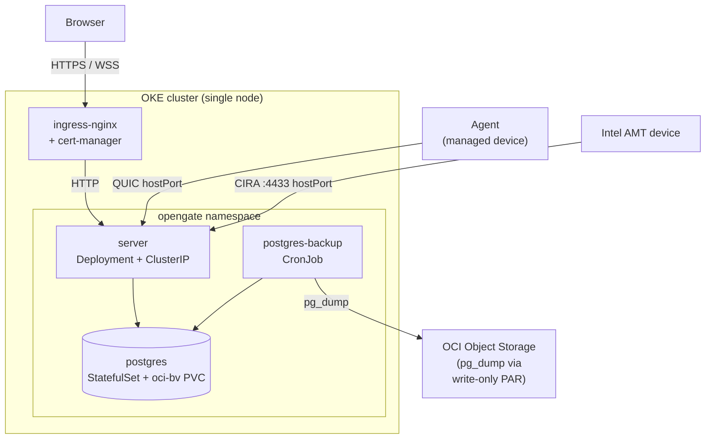

# Kubernetes

- [Cluster layout](#cluster-layout)
- [The Helm chart](#the-helm-chart)
  - [Prerequisites](#prerequisites)
  - [Secrets](#secrets)
  - [QUIC and MPS traffic](#quic-and-mps-traffic)
  - [Shared keys](#shared-keys)
- [The master key](#the-master-key)
  - [Creating it on a new cluster](#creating-it-on-a-new-cluster)
  - [Moving it into its own secret](#moving-it-into-its-own-secret)
  - [Replacing it](#replacing-it)
- [Who may change the cluster](#who-may-change-the-cluster)
  - [The workflows' login](#the-workflows-login)
  - [The cluster job](#the-cluster-job)
- [Validation](#validation)

OpenGate runs on **Oracle Kubernetes Engine (OKE)** via a Helm chart. The
platform decisions are recorded in
[ADR-030](../adr/ADR-030-kubernetes-on-oke.md).

## Cluster layout

The serving shape on the single-node start: HTTP/WSS rides ingress-nginx, while
the non-HTTP L4 transports (QUIC, MPS CIRA) bind the node directly via
`hostPort`. The observability stack is diagrammed separately in
[Monitoring.md](./Monitoring.md).



## The Helm chart

The application chart is [`deploy/helm/opengate`](../../deploy/helm/opengate). Its
templates render:

| Workload | Kubernetes object |
|---|---|
| The server | Deployment + ClusterIP Service (HTTP) + hostPort L4 (QUIC/MPS); it serves the SPA itself (`-web-dir`) |
| The database | StatefulSet + headless Service + `oci-bv` PVC |
| Backups | CronJob (`pg_dump` → OCI Object Storage via a write-only PAR; [ADR-035](../adr/ADR-035-block-volume-budget.md)) |
| The HTTP edge | `Ingress` (ingress-nginx); the cert-manager `ClusterIssuer` is rendered from the chart but applied by [the cluster job](#the-cluster-job) |

The address machines dial for a session is `server.agentRelayURL`, defaulting to
the release's own in-cluster service, and the session helpers the server names
are `server.iceServers` ([`values.yaml`](../../deploy/helm/opengate/values.yaml)).
Production names its public host for the first and its public QUIC host for the
second; staging names its in-cluster service as the helper, so its load runs
carry the helper's traffic.

Environment overlays:
[`values-staging.yaml`](../../deploy/helm/opengate/values-staging.yaml) and
[`values-production.yaml`](../../deploy/helm/opengate/values-production.yaml). The
tunable surface is documented inline in
[`values.yaml`](../../deploy/helm/opengate/values.yaml).

### Prerequisites

Installed once per cluster, outside the chart (the chart's
[`NOTES.txt`](../../deploy/helm/opengate/templates/NOTES.txt) prints the exact
commands):

- **ingress-nginx**, from the repository's
  [`values.yaml`](../../deploy/ingress-nginx/values.yaml) at the chart version in
  [`tool-versions.sh`](../../scripts/lib/tool-versions.sh), with snippet
  annotations off. [`ingress-controller-apply.sh`](../../deploy/scripts/ingress-controller-apply.sh)
  installs it from [the cluster job](#the-cluster-job) and reads it back; its
  `check` mode, run by the nightly configuration job, reads it back and installs
  nothing. A new
  cluster takes the load balancer's subnet from Terraform's `oke_lb_subnet_id`
  output as `INGRESS_LB_SUBNET_ID`; a running one keeps the subnet its Service
  already names. The server sets every security header itself, so the controller
  adds none ([ADR-030](../adr/ADR-030-kubernetes-on-oke.md)).
- **cert-manager** (CRDs + controller), installed by [the cluster job](#the-cluster-job) at the
  chart release [`tool-versions.sh`](../../scripts/lib/tool-versions.sh) pins.

The OKE cluster + node pool are provisioned by the
[`oke` Terraform module](../../deploy/terraform/modules/oke).

### Secrets

The chart never embeds secret material — it references an `existingSecret`
(`server.existingSecret`) created out-of-band, so no secret value lands in git
or in the Helm release history. The master key lives apart, in a secret of its
own ([The master key](#the-master-key)).
[`secrets.example.yaml`](../../deploy/helm/opengate/secrets.example.yaml) lists
every key the secret carries, and the chart's
[`NOTES.txt`](../../deploy/helm/opengate/templates/NOTES.txt) prints the create
command for the release. The passwords and the token-signing secret are
generated:

```bash
kubectl create secret generic opengate-secrets \
  --namespace opengate \
  --from-literal=JWT_SECRET="$(openssl rand -base64 48)" \
  --from-literal=POSTGRES_PASSWORD="$(openssl rand -base64 32)" \
  --from-literal=POSTGRES_APP_PASSWORD="$(openssl rand -base64 32)" \
  --from-literal=AMT_PASS="<intel-amt-admin-password>" \
  --from-literal=VAPID_CONTACT="mailto:ops@example.com" \
  --from-literal=BACKUP_PAR_URL="<par-base-url-ending-in-/o/>"
```

`BACKUP_PAR_URL` is needed only when `postgres.backup.enabled`. It is the base
URL of a write-only OCI Object Storage pre-authenticated request, ending in
`/o/`: the
[backup CronJob](../../deploy/helm/opengate/templates/postgres-backup-cronjob.yaml)
appends a timestamped object name and uploads the dump there. The request
allows writes only, so a leaked URL cannot read the backups back. `NOTES.txt`
prints the commands that create the bucket, the request and its retention
policy.

### QUIC and MPS traffic

QUIC (agent transport, UDP) and Intel AMT CIRA (MPS, TCP) are non-HTTP and
cannot ride the ingress. On the single-node start they bind to the node's
public IP via `hostPort` (`server.hostPortL4`) — see ADR-030 for the
rationale.

### Shared keys

- **`sharedKeys.enabled`** — multi-replica correctness prerequisite. Switches
  `/data` from the per-replica RWO PVC to an `emptyDir`, mounts the VAPID and
  agent-update signing keypairs read-only from `existingSecret`, and fills
  `/data/authority` from the master key's own secret, so every replica serves
  identical key material. It also passes `-ca-must-exist`, so a server that finds
  no master key refuses to start instead of generating a new one.

The VAPID and update-signing files are generated once: the server runs as a
single replica on its volume and writes them to `/data`, they are copied out, and
the secret is recreated with them under the keys `vapid.json` and
`update-signing.json`, beside the values from [Secrets](#secrets):

```bash
mkdir keys && for f in vapid.json update-signing.json; do
  kubectl exec --namespace opengate deploy/opengate-server -- cat "/data/$f" > "keys/$f"
done
kubectl create secret generic opengate-secrets --namespace opengate \
  --from-literal=JWT_SECRET=... \
  --from-file=vapid.json=keys/vapid.json \
  --from-file=update-signing.json=keys/update-signing.json
```

The production overlay enables shared keys. The chart contains only the current
single-replica path: one server replica, in-process relay pairing, and shared key
material mounted from the secret. Serving more than one replica requires a
session-aware autoscaler, a cross-replica session registry, and an L4 path that
pins an agent's control connection — none of which the chart carries.

## The master key

The master key signs every machine's certificate, so whoever holds it can pose as
the server to every machine
([ADR-128](../adr/ADR-128-machine-identity-lifecycle.md)). Its role files live in
the `opengate-authority` secret (`authority.secretName`) and nowhere else:

- the server pod's `authority-stage` start-up step copies them into a memory
  volume readable by the server's user alone
  ([`server-deployment.yaml`](../../deploy/helm/opengate/templates/server-deployment.yaml)),
  and the server refuses to start on a key file anyone else can read;
- a cluster-wide admission rule,
  [`authority-readers.yaml`](../../deploy/cluster/authority-readers.yaml), refuses
  any other pod in `opengate` that mounts the secret or reads it into its
  environment, and each production deploy reads it back
  ([`authority-readers-check.sh`](../../deploy/scripts/authority-readers-check.sh));
- every step that writes it runs the `opengate-authority` tool as a one-shot job
  inside the cluster ([`authority-job.sh`](../../scripts/authority-job.sh), the
  `authority-*` targets in the [`Makefile`](../../Makefile)), which prints roles
  and fingerprints and never a key, and deletes its own objects when it ends.

Each `make authority-*` target runs on the administrator's own login, on the
image the running server uses unless `IMAGE_TAG` names another. `make
authority-inspect` prints what the secret holds.

### Creating it on a new cluster

```bash
make authority-init
```

It creates the issuing master key into the secret and refuses to overwrite one
that exists.

### Moving it into its own secret

A cluster whose master key still sits in `opengate-secrets` moves it once, with
the administrator's login, before the first deploy of a server that reads
`opengate-authority`. The running server's image carries no tool yet, so the job
names the new build's tag:

```bash
IMAGE_TAG=<the new image tag> make authority-adopt
```

The job copies `ca.crt` and `ca.key` into `opengate-authority` and removes them
from `opengate-secrets`.

### Replacing it

The current master key is A and the next is B. The phases and what each admits
are in [ADR-128](../adr/ADR-128-machine-identity-lifecycle.md); the server reads
the role files at start, so each layout is followed by a restart.

```bash
make authority-kit                                   # stage B and B signed by A
make authority-layout PHASE=changeover               # B issues, A still accepted
kubectl -n opengate rollout restart deploy/opengate-server
```

1. **Changeover.** The server offers every machine on A a renewal to B. Wait
   until the daily `authority census` log line shows no live machine on A for
   seven days.
2. **Retire.** `make authority-layout PHASE=retire`, then restart: A admits a
   machine only to renew.
3. **Intel AMT.** Reprovision every AMT device with B's root, then
   `make authority-layout PHASE=retire LAYOUT_FLAGS='-mps new'` and restart;
   A's key is destroyed.
4. **Settle.** Once A's last certificate has passed its expiry plus the grace,
   `make authority-layout PHASE=settle LAYOUT_FLAGS=-drop-old` and restart.

A leaked master key takes the emergency path instead: `make authority-kit`, set
`authority.compromisedSince` to a time safely before the leak, then
`make authority-layout PHASE=emergency` and restart. A machine whose certificate
was issued before that time renews to B within one reconnect; any other is
refused and needs reinstalling. Rotate the Intel AMT credentials as well.

## Who may change the cluster

### The workflows' login

GitHub workflows sign in to the cluster as the `opengate-workflows` cloud user,
from the [`workflow-identity`](../../deploy/terraform/modules/workflow-identity/)
module, whose only cloud right is fetching a kubeconfig. What it may do inside
the cluster is named in
[`workflow-access.yaml`](../../deploy/cluster/workflow-access.yaml): no `list` or
`watch` on any secret, nothing naming `opengate-authority`, and in production no
`get` on `opengate-secrets`. Every Helm call runs with `HELM_DRIVER=configmap`,
because Helm's default keeps release records in secrets and needs `list` on
them. Each deploy asks the cluster, as that login, whether it may read the
master key's secret or list secrets, and fails on a yes
([`workflow-access-readback.sh`](../../deploy/scripts/workflow-access-readback.sh)).

Its key is three repository secrets — `OCI_WORKFLOW_USER_OCID`,
`OCI_WORKFLOW_FINGERPRINT` and `OCI_WORKFLOW_PRIVATE_KEY` — generated by an
administrator for that user; Terraform holds no key material.

### The cluster job

What the workflows' login cannot write is applied by the `cluster` job in
[`cd.yml`](../../.github/workflows/cd.yml), through
[`cluster-apply.sh`](../../deploy/scripts/cluster-apply.sh): the namespaces, the
copy of each release's Helm records into configmaps
([`helm-release-migrate.sh`](../../deploy/scripts/helm-release-migrate.sh)), the
admission rule, cert-manager, the workflows' access, the production certificate
issuer, monitoring's cluster roles and the ingress controller. It runs when a
commit changes one of those pieces or a chart release the manifest pins, or when
the running commit cannot be read, before the staging deploy. It names the `production` environment, so it waits for a
person to approve it, and signs in with the administrator login held only there,
as the environment secrets `OCI_ADMIN_USER_OCID`, `OCI_ADMIN_FINGERPRINT` and
`OCI_ADMIN_PRIVATE_KEY`.

## Validation

`make lint-k8s` is the chart gate (wired into `make lint-deploy`, the precommit
gauntlet, and the CI `config-lint` job):

- `helm lint` + `helm template … | kubeconform -strict` (schema validation,
  CRDs ignored)
- `conftest verify`/`test` against [`policy/k8s`](../../policy/k8s) — image-tag
  hygiene, resource limits, run-as-non-root, health probes
- Checkov's `helm` framework (`make iac-policy`), residual findings tracked as
  documented `skip-check` entries in [`.checkov.yaml`](../../.checkov.yaml)

See [Testing](./Testing.md) for the broader test-layer map and
[CI Pipeline](./CI-Pipeline.md) for where these run.
